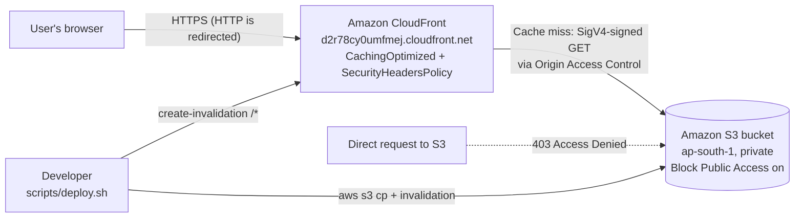
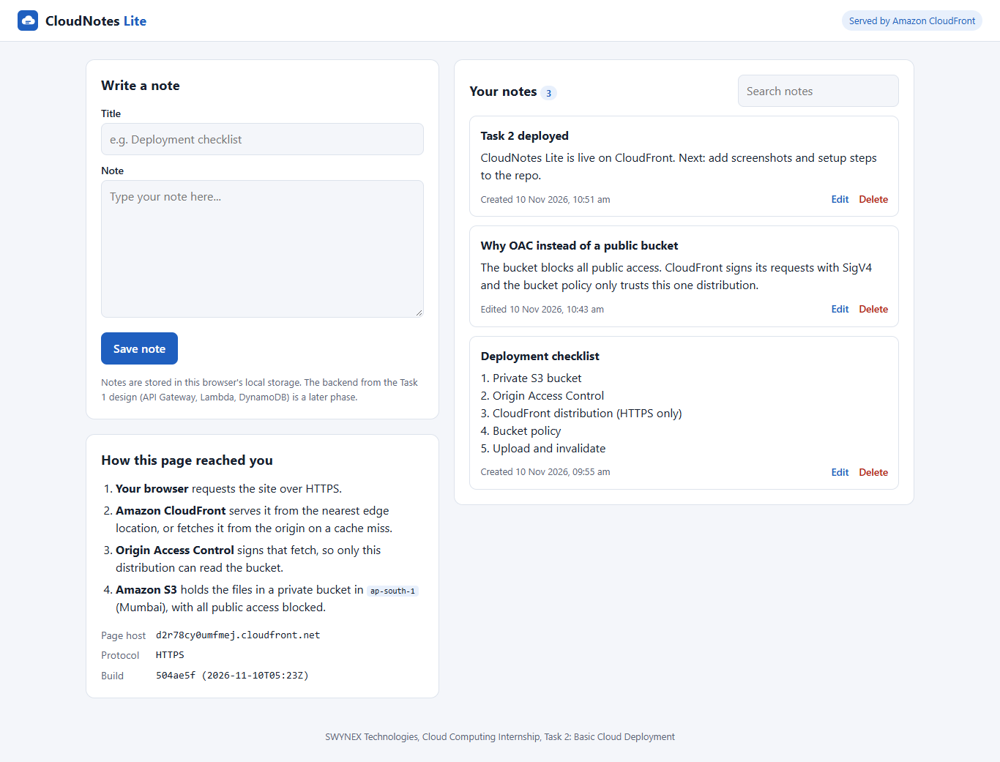
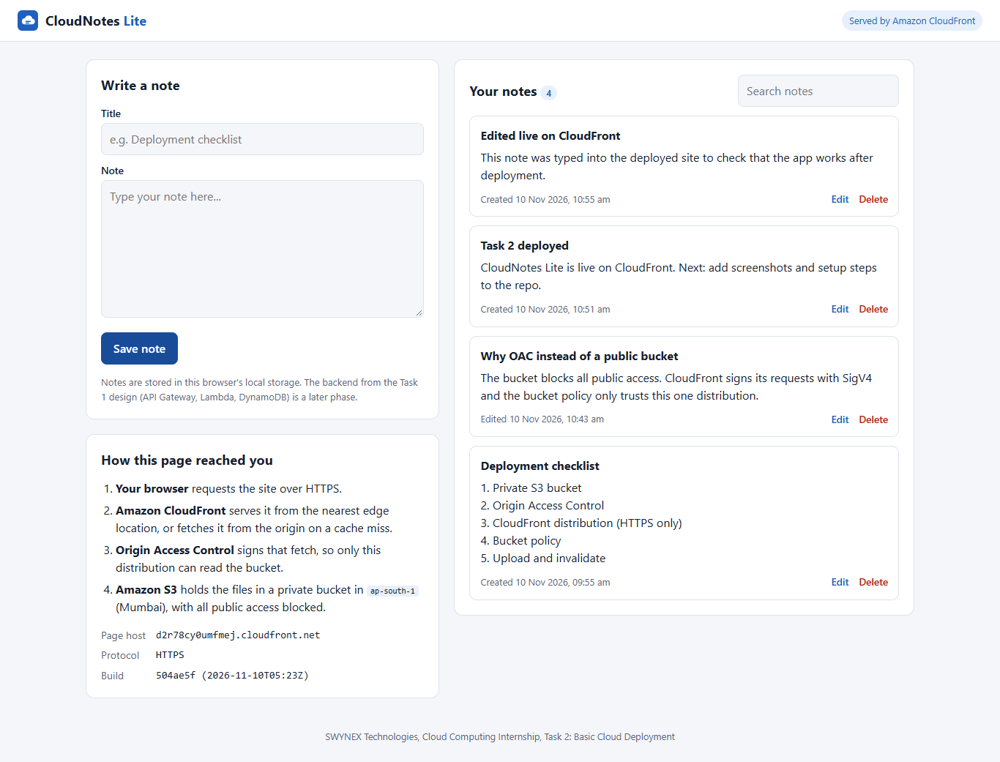
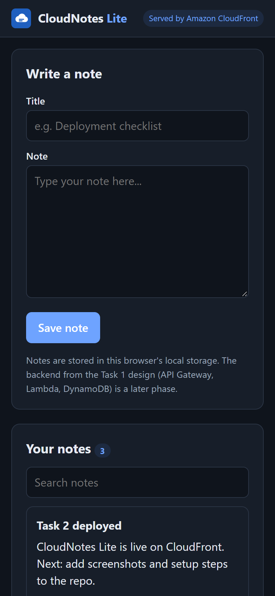
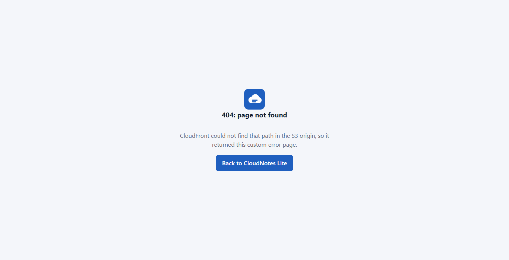
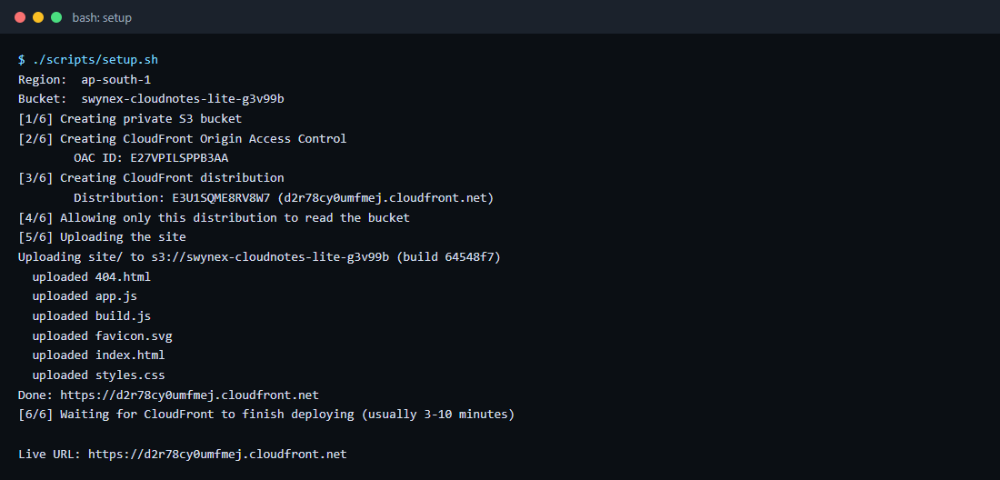
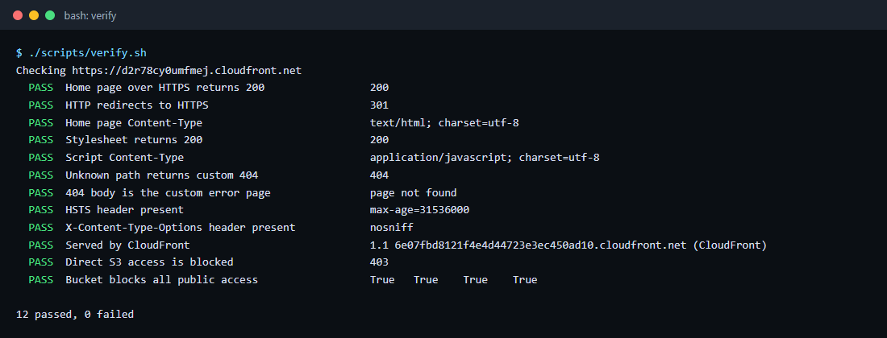

# CloudNotes Lite: Basic Cloud Deployment on AWS

**A static notes app deployed to Amazon S3 and Amazon CloudFront over HTTPS**

**Live URL: https://d2r78cy0umfmej.cloudfront.net**

## Internship task context

| | |
|---|---|
| **Internship** | Cloud Computing Internship, SWYNEX Technologies |
| **Task** | Task 2: Basic Cloud Deployment |
| **Deliverable** | A small app or static site deployed to a public cloud, with screenshots, setup steps and a live URL |
| **Builds on** | [Task 1: CloudNotes cloud architecture outline](https://github.com/YuvanDhurkesh/SWYNEX-Cloud-Architecture-Outline) |

## What was deployed

CloudNotes Lite is the frontend tier of the CloudNotes design from Task 1. It is a working notes app written in plain HTML, CSS and JavaScript. You can create, edit, search and delete notes. Notes are saved in the browser's local storage, because the backend from the Task 1 design (Cognito, API Gateway, Lambda and DynamoDB) is a later phase.

The page also has a **How this page reached you** panel. It shows the host that served the page, the protocol, and the Git commit and time of the deployment.

The hosting follows the frontend part of the Task 1 architecture: files sit in a **private** S3 bucket, and CloudFront serves them over HTTPS through **Origin Access Control**.

## Architecture



1. The browser requests the site over HTTPS. A plain HTTP request gets a 301 redirect to HTTPS.
2. CloudFront answers from the nearest edge cache. On a miss it fetches the file from S3 with a request signed by the Origin Access Control.
3. The bucket policy allows `s3:GetObject` only for this one distribution. Any other request to the bucket, including a direct one from a browser, is denied.
4. CloudFront adds security headers, compresses the response, and returns it.

## AWS services used

| Service | Role |
|---|---|
| Amazon S3 | Stores the site files in a private, encrypted, versioned bucket in `ap-south-1` (Mumbai) |
| Amazon CloudFront | Serves the site over HTTPS from edge locations, caches files, adds security headers, and serves a custom 404 page |
| CloudFront Origin Access Control | Lets CloudFront read the private bucket using signed requests |
| AWS IAM (bucket policy) | Limits read access to the one CloudFront distribution |
| AWS CLI | Creates the resources and uploads the files, using the scripts in this repository |

## Deployment details

| Item | Value |
|---|---|
| Live URL | https://d2r78cy0umfmej.cloudfront.net |
| CloudFront distribution ID | `E3U1SQME8RV8W7` |
| S3 bucket | `swynex-cloudnotes-lite-g3v99b` (ap-south-1) |
| Origin Access Control ID | `E27VPILSPPB3AA` |
| Cache policy | AWS managed `CachingOptimized` |
| Response headers policy | AWS managed `SecurityHeadersPolicy` |
| Price class | `PriceClass_200` (includes edge locations in India) |
| Deployed build | Shown on the live page under **Build** |

## Repository structure

```
SWYNEX-Basic-Cloud-Deployment/
├── site/                     The static app that gets deployed
│   ├── index.html
│   ├── styles.css            Light and dark themes, responsive layout
│   ├── app.js                Notes logic (create, edit, search, delete)
│   ├── build.js              Replaced at deploy time with the commit and time
│   ├── 404.html              Custom error page served by CloudFront
│   └── favicon.svg
├── scripts/
│   ├── setup.sh              One-time setup: bucket, OAC, distribution, bucket policy
│   ├── deploy.sh             Upload site/ and invalidate the CloudFront cache
│   ├── verify.sh             Automated checks against the live deployment
│   └── teardown.sh           Delete every resource setup.sh created
├── docs/
│   ├── setup-steps.md        Step-by-step setup, with CLI and Console instructions
│   └── screenshots/
└── README.md
```

## Setup steps (summary)

The full walkthrough, including the matching AWS Console actions for each step, is in [docs/setup-steps.md](docs/setup-steps.md).

```bash
# 0. Prerequisites: AWS CLI v2 configured (aws configure), Bash, Git
git clone https://github.com/YuvanDhurkesh/SWYNEX-Basic-Cloud-Deployment.git
cd SWYNEX-Basic-Cloud-Deployment

# 1. Create the bucket, OAC, distribution and bucket policy, upload the site,
#    and wait for CloudFront to deploy (about 3 to 10 minutes)
./scripts/setup.sh

# 2. Check the deployment
./scripts/verify.sh

# 3. After changing anything in site/
./scripts/deploy.sh

# 4. Remove everything when finished
./scripts/teardown.sh
```

To preview the app locally first, open `site/index.html` in a browser. No build step is needed.

## Screenshots

### Live site (desktop)


### Creating a note on the deployed site


### Mobile view (dark mode)


### Custom 404 page from CloudFront


### Setup script output


### Verification script output


## Verification

[`scripts/verify.sh`](scripts/verify.sh) was run against the live deployment on 10 November 2026. All 12 checks passed:

```
Checking https://d2r78cy0umfmej.cloudfront.net
  PASS  Home page over HTTPS returns 200                 200
  PASS  HTTP redirects to HTTPS                          301
  PASS  Home page Content-Type                           text/html; charset=utf-8
  PASS  Stylesheet returns 200                           200
  PASS  Script Content-Type                              application/javascript; charset=utf-8
  PASS  Unknown path returns custom 404                  404
  PASS  404 body is the custom error page                page not found
  PASS  HSTS header present                              max-age=31536000
  PASS  X-Content-Type-Options header present            nosniff
  PASS  Served by CloudFront                             1.1 6e07fbd8121f4e4d44723e3ec450ad10.cloudfront.net (CloudFront)
  PASS  Direct S3 access is blocked                      403
  PASS  Bucket blocks all public access                  True  True  True  True

12 passed, 0 failed
```

The **Direct S3 access is blocked** check matters most: requesting `https://swynex-cloudnotes-lite-g3v99b.s3.ap-south-1.amazonaws.com/index.html` returns 403, so the files can only be reached through CloudFront.

### Redeploying an update

The first deployment showed a visible **Cancel edit** button that should have been hidden. A CSS `display` rule was overriding the HTML `hidden` attribute. The fix was committed and shipped with `deploy.sh`, which uploaded the files and invalidated the CloudFront cache:

```
$ ./scripts/deploy.sh
Uploading site/ to s3://swynex-cloudnotes-lite-g3v99b (build 504ae5f)
  uploaded 404.html
  uploaded app.js
  uploaded build.js
  uploaded favicon.svg
  uploaded index.html
  uploaded styles.css
Invalidating CloudFront cache (I4DJ0JPXUZJHV1BTV4SN665D6T)
Done: https://d2r78cy0umfmej.cloudfront.net
```

The live page then showed build `504ae5f`, which confirms the update reached the edge.

## Security choices

- **No public bucket.** Block Public Access is on for all four settings. The S3 static website endpoint is not used, because it cannot be used with OAC and only supports HTTP.
- **Least privilege.** The bucket policy grants only `s3:GetObject`, only to the CloudFront service, and only for this distribution's ARN.
- **HTTPS only.** HTTP requests are redirected to HTTPS, and HSTS tells browsers to use HTTPS from then on.
- **Security headers.** `SecurityHeadersPolicy` adds `Strict-Transport-Security`, `X-Content-Type-Options: nosniff`, `X-Frame-Options: SAMEORIGIN`, `Referrer-Policy` and `X-XSS-Protection`.
- **Encryption at rest.** SSE-S3 with S3 Bucket Keys.
- **Recoverable uploads.** Bucket versioning keeps earlier copies of every file.
- **Read-only methods.** The distribution accepts only GET and HEAD.
- **Safe rendering.** The app inserts note text with `textContent`, never `innerHTML`, so a note cannot inject script.

## Cost

This deployment costs close to nothing:

- **S3:** the site is about 20 KB, so storage costs a fraction of a cent per month, and requests are few because CloudFront caches files.
- **CloudFront:** the AWS Free Tier includes 1 TB of data transfer out and 10 million HTTP(S) requests each month, which this site will not exceed.
- **Invalidations:** the first 1,000 invalidation paths each month are free, and each deploy uses one (`/*`).

Run `./scripts/teardown.sh` to remove everything when it is no longer needed.

## Problems found and how they were fixed

| Problem | Cause | Fix |
|---|---|---|
| A missing page returned **403 Access Denied** instead of 404 | With OAC and no `s3:ListBucket` permission, S3 returns 403 for a missing key, so callers cannot learn which keys exist | Added CloudFront custom error responses that map both 403 and 404 to `/404.html` with status 404 |
| AWS CLI arguments like `/*` were changed into Windows paths under Git Bash | Git Bash converts arguments that look like POSIX paths | The scripts set `MSYS_NO_PATHCONV=1` |
| Content types guessed on Windows can be wrong | `aws s3 sync` guesses MIME types from the local system | `deploy.sh` uploads each file with an explicit `Content-Type` and `Cache-Control` |
| The **Cancel edit** button showed when it should have been hidden | The button's `display: inline-block` rule overrode the browser's default style for the `hidden` attribute | Added `[hidden] { display: none !important; }` and redeployed |
| Updated files did not appear straight away | CloudFront keeps cached copies at edge locations | `deploy.sh` creates an invalidation for `/*` and waits for it to finish |

## Key learnings

- A private bucket behind CloudFront with OAC is the recommended way to host a static site on AWS. A public S3 website bucket is simpler, but it has no HTTPS and exposes the bucket.
- The bucket policy condition `AWS:SourceArn` matters. Without it, any CloudFront distribution in any account could read the bucket through the CloudFront service principal.
- CloudFront changes take several minutes to deploy, while S3 changes are immediate. Cache headers and invalidations decide when users see an update.
- Scripting every step with the AWS CLI makes the deployment repeatable and easy to remove, and the same script doubles as documentation.

## Next steps

Following the Task 1 architecture, the next phases would add Amazon Cognito sign-in, an API Gateway HTTP API with Lambda, and DynamoDB storage, replacing local storage. A custom domain with an ACM certificate and Route 53 could replace the `cloudfront.net` address.
